  

  

# 🛡️ Awesome Cloud Identity Management (IAM) 🚀

**A curated, production-tested directory of enterprise SaaS identity platforms, Zero Trust security frameworks, and self-hosted open-source IAM solutions.**

*Single Sign-On (SSO) 🔑 • Adaptive Multi-Factor Authentication (MFA) 🔐 • Passkeys & FIDO2 🛡️ • Identity Governance & Administration (IGA) 📊 • SCIM Directory Provisioning 🔄 • Model Context Protocol (MCP) & AI Agent Auth 🤖*

---

## 📑 Table of Contents 🎯

- [🌐 Sector Overview & Market Dynamics 📈](#-sector-overview--market-dynamics-)
- [☁️ Enterprise SaaS & Hosted Platforms 🏢](#️-enterprise-saas--hosted-platforms-)
- [🔓 Top Open-Source Identity & Access Management Projects ⭐](#-top-open-source-identity--access-management-projects-)
- [🏛️ Additional Notable Open-Source Solutions 🧩](#️-additional-notable-open-source-solutions-)
- [💡 Architectural Comparison & Decision Matrix 🧠](#-architectural-comparison--decision-matrix-)
- [📈 Star History 📊](#-star-history-)
- [🤝 How to Contribute 🛠️](#-how-to-contribute-️)
- [💖 Support & Sponsorship ☕](#-support--sponsorship-)
- [⚖️ Disclaimer & Compliance 📜](#️-disclaimer--compliance-)

---

## 🌐 Sector Overview & Market Dynamics 📈

The global Identity and Access Management (IAM) and Cloud Identity market is projected at **$24.3B – $27.5B in 2026** (with pure-play cloud IAM software representing ~$10.9B – $13.5B), growing at a compound annual growth rate (CAGR) of 14%–16%. This expansion is propelled by mandatory Zero Trust compliance, distributed remote workforces, automated machine-to-machine workload authentication, and the rapid adoption of AI agents. 

The industry demonstrates **moderate fragmentation**:
- **Top-Tier Enterprise Consolidation:** A concentrated cohort of hyper-scalers and established IAM platforms (Microsoft Entra ID, Okta, CyberArk) captures high-volume enterprise workforce agreements through bundled workplace ecosystems and extensive pre-integrated application catalogs.
- **Active Sub-Domain Fragmentation:** Specialized sectors—including developer Customer IAM (CIAM), hardware-bound passwordless authentication, decentralized identity, and Identity Threat Detection & Response (ITDR)—maintain an agile, innovative landscape where specialized SaaS and self-hosted open-source alternatives thrive.

---

## ☁️ Enterprise SaaS & Hosted Platforms 🏢

*Commercial SaaS platforms sorted in descending order by company valuation / market capitalization.*

| 🏢 Platform | 💰 Valuation / Company Size | 🏷️ Starting Pricing | 🎁 Free Tier / Trial Limits | ⚡ Key Capabilities & Best For |
| :--- | :--- | :--- | :--- | :--- |
| **[Microsoft Entra ID](https://www.microsoft.com/en-us/security/business/identity-access/microsoft-entra-id)** | **$3.1+ Trillion** (Market Cap) | **$7.00/user/mo** (P1 standalone; also bundled in M365 Business Premium / E3); P2 at $10.00/user/mo | **Free plan forever** (capped at 50,000 directory objects without custom domain, 300,000 with verified domain; core directory & SSO included, lacks Conditional Access/PIM) | Enterprise directory, SSO, adaptive MFA, Conditional Access, and deep native Microsoft 365 / Azure integration. Best for Microsoft-centric organizations. |
| **[Atlassian Identity / Guard](https://www.atlassian.com/)** | **~$52 Billion** (Market Cap) | **$4.00/user/mo** (Atlassian Guard Standard for 11–250 users; flat $30/mo for 1–10 users; Guard Premium adds ~$8/user/mo) | **30-day free trial** (unlimited features across connected Atlassian Cloud sites; standard Guard is free for Cloud Enterprise subscribers) | Centralized identity governance, user provisioning (SCIM), SAML SSO, and data loss prevention across Atlassian Cloud (Jira, Confluence). |
| **[Okta](https://www.okta.com/)** | **~$37 Billion** (Market Cap; ~$2.6B+ ARR) | **$6.00/user/mo** (Workforce Starter Suite billed annually; $1,500 annual contract minimum; higher suites at $14–$17/user/mo) | **30-day free trial** (Workforce trial limited to 10 active test users, 1 admin account, capped workflows/integrations; developer account offers 7,500 monthly active users) | Vendor-neutral enterprise cloud identity, pre-built app catalog (7,000+ integrations), adaptive MFA, and lifecycle management. |
| **[CyberArk Identity](https://www.cyberark.com/)** | **~$20.6 Billion** (Market Cap; ~$900M+ ARR) | **$2.00/user/mo** (SSO/MFA starting workforce tier, annual contract with enterprise minimum commitments) | **14-day free trial** (access to interactive cloud sandbox tenant and core identity workflows upon request/lab access) | Identity security platform combining SSO, adaptive multi-factor authentication, and native Privileged Access Management (PAM) threat detection. |
| **[OneLogin](https://www.onelogin.com/)** *(One Identity)* | **$5.4 Billion** (Quest Software parent valuation; ~$150M+ ARR) | **$2.00/user/mo** (Starter plan billed annually; Advanced at $4/user/mo, Professional at $8/user/mo) | **30-day free trial** (full access to enterprise directory integration, single sign-on catalog, and smart MFA evaluation) | Cloud IAM with SmartFactor authentication, unified directory integration, and self-service password reset for mid-market and enterprise organizations. |
| **[Ping Identity](https://www.pingidentity.com/)** | **$2.8 Billion** (Acquisition valuation by Thoma Bravo; combined with ForgeRock) | **$3.00/user/mo** (PingOne for Workforce, 5,000-user enterprise contract minimum; PingOne for Customers starts at ~$35,000/yr) | **30-day free trial** (PingOne cloud platform evaluation sandbox with SSO, MFA, orchestration, and directory capabilities) | Hybrid & multi-cloud enterprise workforce and customer IAM, AI-driven fraud risk engine, and decentralized identity governance. |
| **[JumpCloud](https://jumpcloud.com/)** | **~$2.6 Billion** (Private Valuation; ~$200M ARR) | **$9.00/user/mo** (Device Management or SSO package billed annually, $11/mo monthly; Core Device Identity Management at $13/user/mo) | **30-day free trial** (unrestricted full platform access with all premium features and 24/7 support for evaluation; legacy free tier up to 10 users/devices was grandfathered Feb 2024) | Cloud directory platform unifying cross-OS device management (MDM for Mac, Windows, Linux) with single sign-on, RADIUS, and password management. |
| **[ForgeRock](https://www.forgerock.com/)** *(Ping Identity)* | **$2.3 Billion** (Acquisition valuation by Thoma Bravo) | **$3.00 – $5.00/user/mo** (Workforce enterprise bundle via Ping Identity; customer IAM tiers scaled by identity volume from ~$35K+/yr) | **30-day free trial** (Ping Identity / ForgeRock unified cloud trial environment with identity orchestration and governance modules) | High-scale digital identity, AI-powered identity governance and administration (IGA), autonomous access, and fine-grained authorization. |
| **[Beyond Identity](https://www.beyondidentity.com/)** | **$1.1 Billion** (Series C Unicorn Valuation; ~$38M ARR) | **$6.00/user/mo** (Secure Workforce plan; customer-facing passwordless authentication starts at $0.016/MAU) | **Free plan forever** (Free Passwordless tier for workforce & customer authentication with unlimited users; basic phishing-resistant FIDO2/passkey authentication) | Cryptographic, device-bound passwordless identity eliminating passwords and phishing risks via hardware TPM/Secure Enclave verification. |
| **[Auth0](https://auth0.com/)** *(Okta)* | Part of **Okta ($37B Market Cap)**; acquired for **$6.5 Billion** | **$35.00/month** (B2C Essentials plan up to 500 MAUs; B2B Professional starts at $240/mo for 500 MAUs; enterprise custom) | **Free plan forever** (up to 25,000 Monthly Active Users (MAUs), unlimited social connections, custom domain, and basic attack protection) | Developer-first Customer Identity and Access Management (CIAM) platform offering drop-in authentication, universal login, social auth, and user management APIs. |

---

## 🔓 Top Open-Source Identity & Access Management Projects ⭐

*Self-hosted open-source identity providers, brokers, and auth engines sorted in descending order by GitHub stargazers.*

- **[Keycloak](https://github.com/keycloak/keycloak)** 

  The most widely deployed open-source enterprise IAM platform, backed by Red Hat with the largest global community and integration catalog.
- **Protocols & Features**: Full support for OAuth 2.0 / OpenID Connect (OIDC 1.0) Core, SAML 2.0, Kerberos, LDAP / Active Directory user federation, social login brokers, fine-grained role-based authorization services, administrative REST APIs, and SCIM 2.0 provider integration.
- **Tech Stack & Deployment**: Java (Quarkus-powered runtime), optimized multi-arch container images, official Kubernetes Operator, and Helm charts.
- **Trade-offs**: Java runtime footprint and memory requirements are higher than Go-based equivalents; legacy administration UI can have a steep learning curve.
- **Best For**: Large enterprises, government bodies, and regulated institutions requiring rock-solid reliability, broad third-party plugin support, and deep directory federation.

- **[Authelia](https://github.com/authelia/authelia)** 

  Lightweight, high-performance authentication and authorization companion for reverse proxies and cloud gateways.
- **Protocols & Features**: Companion web portal providing 2-factor authentication (TOTP, WebAuthn / FIDO2 security keys, Duo push notifications), OpenID Connect (OIDC) provider, forward-auth companion for Traefik, Nginx, Envoy, Caddy, and HAProxy.
- **Tech Stack & Deployment**: Go and TypeScript; single ultra-lightweight binary or lean Docker container with minimal resource overhead.
- **Trade-offs**: Purpose-built as a protective proxy companion and OIDC provider rather than a full multi-tenant enterprise identity governance suite.
- **Best For**: DevOps engineers, homelabs, and cloud infrastructure teams seeking an ultra-fast, zero-overhead 2FA / SSO gateway protecting private services.

- **[Authentik](https://github.com/goauthentik/authentik)** 

  Modern, flexible open-source identity provider and the community favorite for Keycloak migration.
- **Protocols & Features**: OAuth2 / OIDC, SAML 2.0, LDAP outpost server, forward authentication proxy provider, SCIM 2.0 directory sync, and an unmatched stage-based visual flow engine enabling total customization of authentication and onboarding journeys.
- **Tech Stack & Deployment**: Python (Django) core, Go outposts/reverse proxies, Vue.js admin and user portals; deployed via Docker Compose or Kubernetes Helm charts.
- **Trade-offs**: Python backend has a moderate memory footprint compared to pure Go engines; advanced enterprise multitenancy requires commercial tiers.
- **Best For**: Engineering teams wanting modern UX, frictionless self-service user portals, and infinitely configurable visual authentication flows.

- **[Ory Hydra](https://github.com/ory/hydra)** 

  Hardened, OpenID Foundation-certified OAuth 2.0 and OpenID Connect engine built for ultra-high throughput.
- **Protocols & Features**: OpenID Certified® OAuth 2.0 and OIDC provider, headless architecture (BYO login and consent UI in any language), cryptographically signed JWT issuance, token introspection, and instant revocation at massive concurrency.
- **Tech Stack & Deployment**: Go; stateless microservice connecting to PostgreSQL, MySQL, CockroachDB, or SQLite.
- **Trade-offs**: Headless by design—does not include a built-in user management UI or user directory; pairs with Ory Kratos or external user stores.
- **Best For**: High-throughput microservice architectures, fintech platforms, and API ecosystems requiring strict OpenID Connect compliance and sub-millisecond token issuance.

- **[Zitadel](https://github.com/zitadel/zitadel)** 

  Cloud-native, multi-tenant identity infrastructure built for modern B2B SaaS and Kubernetes environments.
- **Protocols & Features**: OIDC, OAuth 2.0, SAML 2.0, Passkeys / WebAuthn, event-sourced architecture (audit trail built into every transaction), built-in organizations for seamless multi-tenancy, and machine-to-machine service accounts.
- **Tech Stack & Deployment**: Go, CockroachDB / PostgreSQL, Next.js / TypeScript UI; instant cold starts and minimal memory consumption.
- **Trade-offs**: Event-sourced DB schema requires CockroachDB or modern Postgres; smaller community ecosystem than Keycloak.
- **Best For**: B2B SaaS engineering teams and Kubernetes platform operators needing clean multi-tenancy out of the box and rapid passkey authentication.

- **[SuperTokens](https://github.com/supertokens/supertokens-core)** 

  Developer-first, modular open-source alternative to Auth0 and Firebase Auth with pre-built UI components.
- **Protocols & Features**: Secure session management with automatic rotating refresh tokens, passwordless authentication (magic links, SMS OTP), social login connectors, user roles / permissions (RBAC), and multi-factor authentication (MFA).
- **Tech Stack & Deployment**: Java core service engine with SDKs across React, Next.js, Angular, Vue, Node.js, Python, Go, and mobile frameworks.
- **Trade-offs**: Focuses on application-level CIAM (customer identity) rather than enterprise workforce desktop SSO or LDAP directory services.
- **Best For**: Full-stack application developers needing customizable drop-in authentication components, secure cookie-based session management, and self-hosted data ownership.

- **[Logto](https://github.com/logto-io/logto)** 

  Modern Auth0 alternative designed for B2B SaaS, mobile apps, and multi-tenant architectures.
- **Protocols & Features**: OIDC / OAuth 2.0 provider, enterprise SSO (SAML/OIDC connectors for Okta, Google Workspace, Entra ID), WebAuthn passkeys, organization-level RBAC for multi-tenant applications, and automated email/SMS verification.
- **Tech Stack & Deployment**: Node.js, TypeScript, PostgreSQL; packaged as Docker images with complete Admin Console and end-user sign-in UI.
- **Trade-offs**: Focuses on modern web/app CIAM and multi-tenant B2B apps rather than legacy enterprise on-premise Active Directory federation.
- **Best For**: Modern software engineering teams building consumer applications or multi-tenant B2B SaaS platforms wanting a slick Auth0 substitute.

- **[Casdoor](https://github.com/casdoor/casdoor)** 

  AI-native Identity and Access Management (IAM) / SSO platform with web UI and native Model Context Protocol (MCP) server.
- **Protocols & Features**: OAuth 2.0 / OIDC provider, SAML 2.0 IdP, built-in CAS, LDAP, and RADIUS servers, WebAuthn / Passkeys, Face ID biometric auth, **MCP server and OAuth 2.1 for MCP built-in** (native support for AI agents), SCIM 2.0 server, syncers for Keycloak, Okta, Entra ID, and 70+ built-in social/enterprise providers.
- **Tech Stack & Deployment**: Go (backend), React (UI); single binary plus database (MySQL, PostgreSQL, CockroachDB, SQLite).
- **Trade-offs**: Rapid development cycle means docs can occasionally lag bleeding-edge features; smaller community footprint than Keycloak.
- **Best For**: Engineering teams wanting broadest protocol support in a single Go binary—especially those implementing AI agents via Model Context Protocol (MCP) or needing CAS/LDAP/RADIUS without plugins.

- **[Ory Kratos](https://github.com/ory/kratos)** 

  Cloud-native, headless user management and identity system providing clean APIs for user lifecycle.
- **Protocols & Features**: Headless identity lifecycle (self-service registration, login, profile management, password recovery, verification), multi-factor authentication (TOTP, WebAuthn), social sign-in, and customizable JSON Schema identity definitions.
- **Tech Stack & Deployment**: Go; zero-state binary connecting to relational databases (PostgreSQL, MySQL, CockroachDB, SQLite).
- **Trade-offs**: Purely headless—requires teams to build or embed custom UI using Ory Elements or their own frontend framework.
- **Best For**: Product teams building custom, branded user authentication flows that demand full UI freedom with rock-solid security guarantees.

- **[Dex IdP](https://github.com/dexidp/dex)** 

  Federated OpenID Connect (OIDC) identity broker and gateway for Kubernetes and cloud platforms.
- **Protocols & Features**: Acts as an identity broker, delegating authentication to upstream providers (LDAP, SAML, GitHub, Google, Microsoft, GitLab) and emitting standard OIDC tokens for downstream consumers (Kubernetes API server, ArgoCD, Grafana).
- **Tech Stack & Deployment**: Go; lightweight single binary, native Kubernetes deployment with CRDs or config maps.
- **Trade-offs**: Does not manage user credentials or maintain internal user directories—strictly acts as a federation proxy.
- **Best For**: Infrastructure and platform engineering teams configuring cluster-wide SSO for Kubernetes, CI/CD tools, and internal infrastructure dashboards.

- **[HashiCorp Boundary](https://github.com/hashicorp/boundary)** 

  Identity-based secure remote access and privileged session management without managing private network VPNs.
- **Protocols & Features**: Dynamic credential injection, identity-based TCP session brokering, OIDC identity integration, automated discovery of targets across multi-cloud environments, and session auditing.
- **Tech Stack & Deployment**: Go; multi-node controller and worker architecture backed by PostgreSQL.
- **Trade-offs**: BSL licensing limits certain managed service hosting models; complements rather than replaces an identity provider (IdP).
- **Best For**: Securing SSH, Kubernetes, and database access for cloud operations and engineering teams using identity instead of IP whitelists or bastion hosts.

- **[Janssen Project](https://github.com/JanssenProject/jans)** 

  Linux Foundation-governed enterprise IAM and OpenID certified platform recognized as a Digital Public Good.
- **Protocols & Features**: Jans Auth Server (OpenID Certified® OAuth 2.0 / OIDC / FIDO2 / UMA 2.0), Agama low-code authentication orchestration DSL, Jans SCIM directory services, and Jans Cedarling (Rust/WASM policy decision point).
- **Tech Stack & Deployment**: Java, Python, Rust; highly scalable Kubernetes deployment architecture.
- **Trade-offs**: High architecture complexity; geared for government, telecommunications, and hyperscale environments rather than quick SMB setups.
- **Best For**: Public sector organizations, national identity systems, and regulated enterprises demanding Linux Foundation governance and strict open-standard verification.

- **[Apache Syncope](https://github.com/apache/syncope)** 

  The top-level Apache Foundation solution for Identity Governance and Administration (IGA) and provisioning.
- **Protocols & Features**: Identity lifecycle management, automated identity provisioning and deprovisioning to external systems via ConnId connectors, role and entitlement management, workflow-driven approvals (Flowable engine), and reporting.
- **Tech Stack & Deployment**: Java, Spring Boot, Apache Wicket UI; enterprise container or application server deployment.
- **Trade-offs**: Traditional enterprise Java architecture; higher setup complexity compared to lightweight auth proxies.
- **Best For**: Enterprise organizations needing comprehensive Identity Governance and Administration (IGA) with bi-directional connector provisioning across legacy and cloud applications.

---

## 🏛️ Additional Notable Open-Source Solutions 🧩

- **[Shibboleth Consortium](https://www.shibboleth.net/)** — Open-source web-based SSO and federated authentication protocol suite tailored specifically for higher education, scientific research consortia, and cross-institutional identity federations (InCommon, eduGAIN).
- **[FreeIPA](https://www.freeipa.org/)** — Integrated security information management solution providing central authentication, authorization, Kerberos KDC, 389 Directory Server (LDAP), DNS, and certificate management for networked Linux/UNIX environments. Often deployed in tandem with Keycloak to provide SSO on top of complete POSIX/directory management.

---

## 💡 Architectural Comparison & Decision Matrix 🧠

Choosing the appropriate identity platform depends on organizational boundaries, hosting autonomy, and compliance obligations:

1. **Enterprise Workforce IAM Platforms** (*Microsoft Entra ID, Okta, Ping Identity, CyberArk, OneLogin, JumpCloud*):
   - **Focus:** Employee desktop logons, company-wide Single Sign-On (SSO), automated SCIM lifecycle provisioning, corporate directory governance, and SaaS application integration catalogs.
   - **Trade-off:** Commercial licensing costs, per-seat recurring fees, and potential vendor lock-in.

2. **Developer CIAM Platforms** (*Auth0, SuperTokens, Logto*):
   - **Focus:** Frictionless login boxes, social sign-ins, passkeys, self-service password reset, and embeddable frontend SDKs for web and mobile consumer applications.
   - **Trade-off:** Usage-based billing scaling by Monthly Active Users (MAUs).

3. **Modern Self-Hosted IAM Suites** (*Authentik, Casdoor, Zitadel, Keycloak*):
   - **Focus:** Complete operational control over authentication pipelines, zero per-seat software licensing overhead, and hosting freedom (Kubernetes, bare metal, on-premise air-gapped data centers).
   - **Differentiators:** **Casdoor** delivers built-in MCP server support for AI agents and legacy protocol support (CAS, LDAP, RADIUS); **Authentik** provides modern UI with intuitive flow engines; **Zitadel** brings cloud-native Go efficiency and multi-tenant isolation; **Keycloak** offers the largest enterprise plugin ecosystem and Red Hat backing.

4. **Headless & Microservice Auth Engines** (*Ory Hydra, Ory Kratos, Dex IdP*):
   - **Focus:** Sub-millisecond token issuance, microservice authorization pipelines, and total design freedom to build customized branded authentication interfaces.
   - **Trade-off:** Requires engineering assembly; does not deliver monolithic out-of-the-box user portals.

---

## 📈 Star History 📊

---

## 🤝 How to Contribute 🛠️

Contributions are very welcome! If you know of an outstanding open-source identity project or major enterprise identity platform:

1. 🍴 **Fork the repository** to your GitHub account.
2. 🌿 **Create a new branch** (`git checkout -b feature/add-new-identity-tool`).
3. ✍️ **Add or edit entries in `README.md`** following the established format (ensure links, badges, Stars_Counts, and objective descriptions are verified).
4. 💾 **Commit your changes** (`git commit -m 'Add ToolName to Open-Source IAM section'`).
5. 🚀 **Push to your branch** (`git push origin feature/add-new-identity-tool`).
6. 📬 **Submit a Pull Request** with a concise explanation of your additions.

---

## 💖 Support & Sponsorship ☕

If you found **Awesome Cloud Identity Management** valuable, informative, or helpful in designing your organization's identity architecture, please consider supporting the project:

- 🌟 **Star this repository** on GitHub to help others discover it.
- 🍴 **Fork the repo** and contribute updates or new tools.
- 📢 **Share the project** with fellow DevOps, security engineers, and identity architects on LinkedIn, X/Twitter, and tech forums.
- ☕ **Buy a coffee & sponsor ongoing maintenance:** Support the author directly via the [GitHub Sponsors Dashboard](https://github.com/sponsors/ishandutta2007).

---

## ⚖️ Disclaimer & Compliance 📜

- 🛡️ **Community-Curated Directory:** This collection is compiled for educational and architectural evaluation purposes. Mention of proprietary SaaS products or open-source repositories does not represent an official endorsement.
- 🔒 **Security Best Practices:** Identity and Access Management systems handle confidential authentication secrets, private encryption keys, and sensitive personal information. Always enforce multi-factor authentication (MFA), ensure compliance with privacy regulations (GDPR, CCPA, HIPAA), enforce continuous audit logging, and perform regular security audits before deploying any identity provider in production.

---

**Crafted with ❤️ for cloud architects, security engineers, and open-source identity builders.**  
*Let's make Cloud Identity Management more secure, transparent, and passwordless.*

